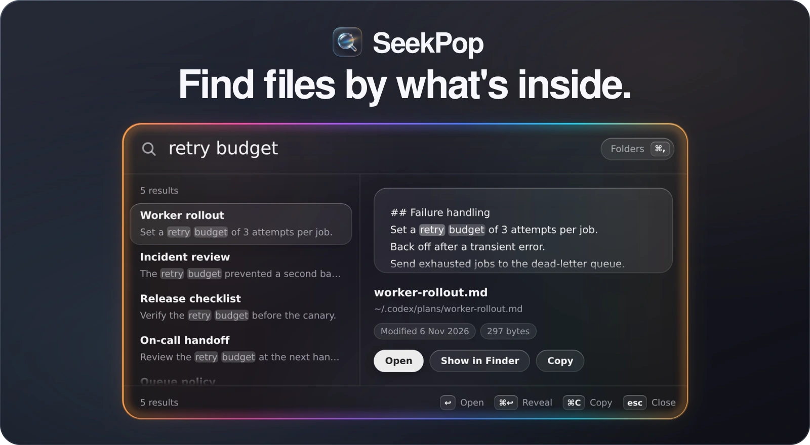
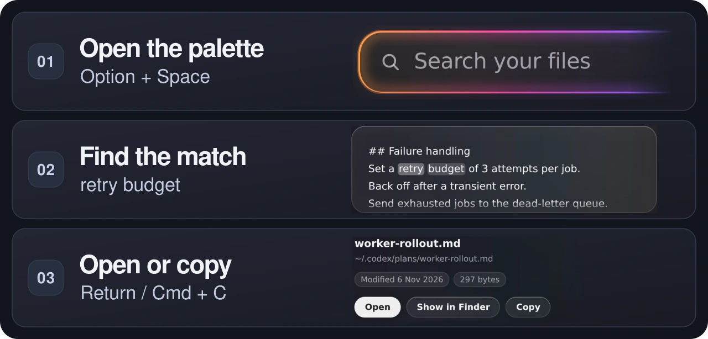

<h1 align="center">
  
</h1>

<p align="center">
  <strong>Your hidden files deserve to be found.</strong><br>
  Press <kbd>Option</kbd> + <kbd>Space</kbd> to search the text inside local files, even in folders like <code>~/.codex/plans</code>.
</p>

<p align="center">
  <a href="#quick-start"><strong>Quick start</strong></a> · <a href="#see-it-in-action">See it in action</a><br>
  macOS · Hammerspoon + ripgrep · No index to build
</p>

## Why I built SeekPop

I built SeekPop to search the Markdown plans Codex saves in `~/.codex/plans`. I'd remember a phrase and forget which file held it. I wanted to search those files in place with a shortcut I could use from any app.

- **Search hidden folders**. Choose where to look, including `~/.config`, your Codex plans, or any project notes folder you can read. See [search limits](#search-limits) for ignore rules and file access.
- **No index to refresh**. ripgrep scans the selected folders on each query, so your next search picks up new and edited Markdown files. Setup needs no AI model.
- **Preview and copy**. Search by name or by text, read the highlighted match in context, then open the file, copy it, or copy its path from the keyboard.

DigUp was one of the tools I looked at. It indexes documents and media on-device for semantic search and also matches exact text in filenames and documents. [DigUp README](https://github.com/ARahim3/DigUp#readme)

## See it in action



*The banner and walkthrough use SeekPop's webview rendered in a browser with sample files.*

1. Open SeekPop with <kbd>Option</kbd> + <kbd>Space</kbd>. Choose **Folders**, then **Add folder…**. In the picker, use <kbd>Cmd</kbd> + <kbd>Shift</kbd> + <kbd>G</kbd> to go to `~/.codex/plans` and select it.
2. Press <kbd>Esc</kbd> to return to the search bar, then type a phrase from one of your plans. The demo uses `retry budget`. Use <kbd>↑</kbd> and <kbd>↓</kbd> to preview each file with its matches highlighted.
3. Press <kbd>Return</kbd> to open the selected file, <kbd>Cmd</kbd> + <kbd>C</kbd> to copy the file for pasting in Finder, or <kbd>Cmd</kbd> + <kbd>Shift</kbd> + <kbd>C</kbd> to copy its path as text.

## Quick start

SeekPop runs as a Hammerspoon Spoon on macOS. You need [Hammerspoon](https://www.hammerspoon.org/) and [ripgrep](https://github.com/BurntSushi/ripgrep). SeekPop has been tested with Hammerspoon 1.1.1 on macOS 26.

1. Install the dependencies with [Homebrew](https://brew.sh/) and launch Hammerspoon. Grant Hammerspoon Accessibility access when prompted so it can register the hotkey.

   ```sh
   brew install --cask hammerspoon
   brew install ripgrep
   open -a Hammerspoon
   ```

2. Clone SeekPop and link the Spoon.

   ```sh
   mkdir -p "$HOME/develop" "$HOME/.hammerspoon/Spoons"
   git clone https://github.com/duarbdhks/seekpop.git "$HOME/develop/seekpop"
   ln -s "$HOME/develop/seekpop/SeekPop.spoon" "$HOME/.hammerspoon/Spoons/SeekPop.spoon"
   ```

3. Add these lines to `~/.hammerspoon/init.lua`. Create the file if needed, then choose **Reload Config** from Hammerspoon's menu bar icon.

   ```lua
   hs.loadSpoon("SeekPop")
   spoon.SeekPop:bindHotkeys({ toggle = { { "alt" }, "space" } })
   spoon.SeekPop:start()
   ```

4. Press <kbd>Option</kbd> + <kbd>Space</kbd>, choose **Folders**, and add a folder with a few text files. Search for a phrase you remember from one of them.

## Keyboard shortcuts

| Shortcut | Action |
| --- | --- |
| Option + Space | Open or close SeekPop |
| ↑ / ↓ or Ctrl + P / Ctrl + N | Move through results |
| Return | Open the file in its default app. Press it while a query is running to open the first result when it arrives. |
| Cmd + Return | Reveal the file in Finder |
| Cmd + C | Copy the file. If you have selected query or preview text, copy that text. |
| Cmd + Shift + C | Copy the file path as text |
| Cmd + , | Show or hide the folder list |
| Esc | Close the folder list, then the palette |

## How it works

Hammerspoon handles the hotkey, window, and macOS file actions. Searches and previews run locally.

All query terms must appear in the file's contents or all must appear in its name. Matching is case-insensitive, and terms in the contents can appear on different lines. Results are sorted by most recently modified, with up to 50 shown by default. A Markdown heading near the top of a file becomes its result title when available. Each result can show a matching line, and its preview highlights matching text.

## Configuration

**Search folders.** SeekPop starts with an empty folder list. Open **Folders** with <kbd>Cmd</kbd> + <kbd>,</kbd> and choose **Add folder…**. In the picker, use <kbd>Cmd</kbd> + <kbd>Shift</kbd> + <kbd>.</kbd> to show hidden folders, or <kbd>Cmd</kbd> + <kbd>Shift</kbd> + <kbd>G</kbd> to type a path. Hammerspoon saves the list as `SeekPop.roots`.

Set these fields on `spoon.SeekPop` after `hs.loadSpoon` and before `start()`.

| Field | Default | Purpose |
| --- | --- | --- |
| `rgPath` | First available of `/opt/homebrew/bin/rg` and `/usr/local/bin/rg` | Absolute path to ripgrep |
| `maxResults` | `50` | Maximum results per query |
| `maxFileSize` | `"2M"` | Size limit for content search, in ripgrep units |
| `exclude` | `.git`, `node_modules`, `dist`, `build`, `.next`, `.DS_Store` | Files and folders to skip at any depth |

**Appearance and privacy.** The palette follows macOS light or dark mode and Reduce Motion. It uses tinted glass by default when Hammerspoon lacks Screen Recording permission. To enable desktop blur, choose **Turn on** in the folder list or allow Hammerspoon in **System Settings → Privacy & Security → Screen & System Audio Recording**. SeekPop captures a still of the area behind the palette when it opens and keeps it in memory. It never writes that image to disk.

### Search limits

ripgrep honors applicable ignore rules such as `.gitignore` and the `exclude` list above, including inside hidden folders. Hammerspoon needs read access to the folders and files you want to search.

Content search skips binary files and files above the size limit. Their names can still match. Previews show up to 256 KB of UTF-8 text. Searching inside PDFs is on the roadmap.

<details>
<summary>Optional launcher and startup at login</summary>

After setting up the Spoon, run this command to open SeekPop from Spotlight, Launchpad, or the Dock.

```sh
"$HOME/develop/seekpop/scripts/install-app.sh"
```

The script builds `~/Applications/SeekPop.app` and uses `app/AppIcon.png` for its icon. The launcher starts Hammerspoon if needed, then sends it `hammerspoon://seekpop` to open the palette. Rerun the script after pulling launcher or icon updates.

Enable **Launch Hammerspoon at login** in Hammerspoon settings, or run `hs.autoLaunch(true)` in the Hammerspoon console, to have SeekPop ready at login.

</details>

## Troubleshooting

- **Option + Space does nothing.** Check that Hammerspoon is running, has Accessibility access, and has reloaded its config. If a launcher such as ChatGPT is already using the shortcut, change one of the bindings in its settings or in `bindHotkeys`.
- **ripgrep was not found.** Run `command -v rg` in Terminal. Install ripgrep if it is missing, or set `spoon.SeekPop.rgPath` to the absolute path it prints and reload Hammerspoon.
- **A file is missing from results.** Check that its folder is in **Folders** and that Hammerspoon can read it. Check ripgrep's ignore rules, then try searching by filename.

## Development and license

Run the search tests from the repository root with Hammerspoon's `hs` CLI installed and `require("hs.ipc")` in your Hammerspoon config.

```sh
hs -c "dofile('$PWD/tests/search_test.lua')"
```

SeekPop is released under the [MIT License](LICENSE).
